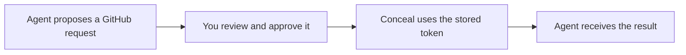

# Conceal

**Keep API keys out of your project files.**

Conceal stores keys in your operating system's credential store and uses them when needed. Use the CLI to launch a trusted app, or the desktop inbox to review an agent's service request before it runs. It works on macOS, Windows, and Linux, with no hosted service to set up.

This branch is the **4.3 release candidate**. The app runner and reviewed GitHub actions below require this candidate; Homebrew and Chocolatey still install the stable release. [Install the candidate](docs/getting-started.md#install-the-release-candidate).

## What would you like to do?

### Run my app with a stored key

Save a key once, then give it to a program when you launch it:

```sh
conceal set my-app/api-key
conceal run --env API_TOKEN=my-app/api-key -- python app.py
```

The first command prompts for the key without displaying it. The second starts your app with `API_TOKEN` set. Your app receives the real key, so use this with programs you trust.

**[Try a complete Python example with a made-up key](docs/getting-started.md#run-your-first-app)** — includes expected output and cleanup.

### Review an agent's request before it runs

Suppose a coding agent wants to open a draft pull request. Instead of giving it your GitHub token, you review the repository, title, and branches. Conceal can then use the token to send that approved request once.



The candidate supports **listing GitHub issues**, **opening a draft PR from an already pushed branch**, and **listing S3 object names under an allowed bucket prefix**. An approval expires and cannot be reused. Changing the request requires a new approval.

**[Open the desktop approval inbox](docs/desktop.md)** — review the target, complete inputs, and credential names in one screen. Approve once, then choose when to run. Practice mode lets you try both GitHub and S3 without real keys.

**[Explore the interactive playground](docs/playground.html)** — open the downloaded HTML file in a browser, or run `python -m http.server 8000` in this checkout and visit [localhost:8000/docs/playground.html](http://localhost:8000/docs/playground.html). The demo uses no keys and makes no API calls. GitHub displays the file's source rather than running it.

**[Try GitHub without a token](docs/actions.md#try-it-without-a-token)** or **[list backup names in S3](docs/aws.md)**, then follow the guide for a real request.

Today, an operator runs the approval workflow in a trusted environment. Connecting an untrusted agent requires a separately configured boundary: **this candidate does not include an agent connector or sandbox**. An agent with unrestricted access to your account could approve requests or read your keys itself. [Understand the deployment requirements](docs/actions.md#the-trust-boundary).

### Keep using Summon

Conceal can supply locally stored keys to your existing `secrets.yml` workflow. Summon is optional; there is no need to replace it.

**[Connect Conceal to Summon](docs/getting-started.md#use-your-existing-summon-workflow)** — includes a complete mapping and provider setup.

## Before you use real keys

macOS uses Keychain, Windows uses Credential Manager, and Linux uses the kernel user keyring. **Linux keys are held in memory and do not survive reboot**; some containers block keyring access. See [platform requirements](docs/reference.md#platforms).

Conceal protects neither a compromised account nor an unrestricted agent running as that account. See the [security policy](SECURITY.md) for the scope and limits of each workflow.

## Go further

Want Conceal to work with another service? **[Build an adapter](docs/adapters.md)** using the public Go SDK, starter, and shared tests. The existing approval engine and desktop handle the review flow.

[Command and platform reference](docs/reference.md) · [Action guide](docs/actions.md) · [Contributing](CONTRIBUTING.md) · [Release checks](https://github.com/infamousjoeg/conceal/actions/workflows/test-release.yml)

Maintained by [Joe Garcia](https://github.com/infamousjoeg). Licensed under [Apache 2.0](LICENSE).
